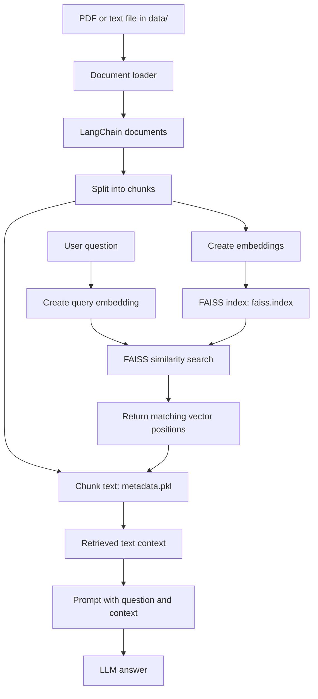

# RAG Tutorial

This project demonstrates a simple **Retrieval-Augmented Generation (RAG)**
pipeline.

1. Load documents with loaders such as `PyPDFLoader`.
2. Split documents into overlapping chunks.
3. Convert chunks into embedding vectors.
4. Store vectors in FAISS index saved as `faiss.index` and store their related text in `metadata.pkl`.
5. Convert the user’s question into an embedding vector using the same embedding model.
6. Perform a similarity search in `faiss.index` to find the closest chunk vectors.
7. Use the returned vector positions to retrieve the matching chunk text from metadata.pkl.
8. Use the matching text as context for the LLM prompt and generate final answer.

## RAG flow



## Simple Example

Suppose a document contains:

```text
Attention helps a model focus on important words.
FAISS searches similar text using embeddings.
```

After chunking:

```python
chunks = [
    "Attention helps a model focus on important words.",
    "FAISS searches similar text using embeddings.",
]
```

After embedding, the real model produces vectors similar to:

```python
embeddings = [
    [0.10, 0.20, 0.90],  # chunk 0
    [0.80, 0.30, 0.15],  # chunk 1
]
```

The vectors are saved in `faiss_store/faiss.index`. The current code creates
the matching metadata as:

```python
metadata = [
    {"text": "Attention helps a model focus on important words."},
    {"text": "FAISS searches similar text using embeddings."},
]
```

This metadata is saved in `faiss_store/metadata.pkl`.

The positions must match:

```text
faiss.index vector 0  <->  metadata.pkl item 0  <->  first chunk
faiss.index vector 1  <->  metadata.pkl item 1  <->  second chunk
```

For the question:

```text
What helps a model focus on important words?
```

the question is embedded and searched in FAISS. If FAISS returns position
`0`, the program reads `metadata[0]`, retrieves the first chunk, and places
it in the LLM prompt:

```text
Summarize the following context for the query:
'What helps a model focus on important words?'

Context:
Attention helps a model focus on important words.

Summary:
```

In short:

```text
faiss.index  = searchable embedding vectors
metadata.pkl = text/details connected to those vectors
```

## Chunking and embeddings

`EmbeddingPipeline` uses:

```text
Embedding model: all-MiniLM-L6-v2
Chunk size:     1000 characters
Chunk overlap:  200 characters
```

The overlap means neighboring chunks may look like:

```text
Chunk 1: characters 0-1000
Chunk 2: characters 800-1800
```

The `all-MiniLM-L6-v2` model produces 384-dimensional vectors. The exact
number of values depends on the selected embedding model.

## Project structure

```text
RAG_tutorial/
├── data/
│   ├── pdf/                  # Source PDF documents
│   ├── text_files/           # Source text documents
│   └── vector_store/         # Chroma files created during experiments
├── faiss_store/
│   ├── faiss.index           # FAISS embedding index
│   └── metadata.pkl          # Text related to each vector position
├── notebook/
│   ├── document.ipynb        # Basic document processing and metadata learning
│   └── pdf_loader.ipynb      # End-to-end PDF/RAG experiments
├── src/
│   ├── __init__.py            # Makes src importable as a package
│   ├── data_loader.py         # Loads PDF, TXT, CSV, Excel, Word, and JSON files
│   ├── embedding.py           # Splits documents and creates embeddings
│   ├── vector_store.py        # Builds, saves, loads, and searches FAISS
│   └── search.py              # Retrieves context and calls the LLM
├── app.py                     # Example RAG application entry point
├── main.py                    # Basic project entry point
├── pyproject.toml             # Project and uv dependencies
├── requirements.txt           # Dependency list
└── uv.lock                    # Locked uv dependency versions
```

## What each `src` file does

### `src/data_loader.py`

Finds supported files under `data/`, loads them, and returns LangChain documents. Each loaded document contains actual text in `page_content` and may contain source/page information in `metadata`. The current FAISS implementation saves the chunk text in `metadata.pkl`.

### `src/embedding.py`

Splits loaded documents into smaller overlapping chunks and converts the
chunk text into embedding vectors.

### `src/vector_store.py`

Creates a FAISS `IndexFlatL2`, adds the chunk vectors, keeps the related chunk
text in the same order, and saves/loads:

```text
faiss_store/faiss.index
faiss_store/metadata.pkl
```

For a query, it embeds the question and asks FAISS for the nearest chunks.

### `src/search.py`

Creates or loads the vector store, retrieves the top matching chunks, joins
them into context, builds a prompt, and sends that prompt to the Groq LLM.

## Notebook directory purpose

### `notebook/document.ipynb`

Used to learn document processing and the difference between:

- `page_content`: the actual document text
- `metadata`: information about the document, such as source or page number

### `notebook/pdf_loader.ipynb`

Used to demonstrate the complete RAG workflow:

```text
PDF loading -> chunking -> embeddings -> vector database -> similarity search
```

## Commands

Run these commands from the project root:

```powershell
# Install/synchronize the project environment from pyproject.toml and uv.lock
uv sync

# These commands are mainly for testing individual stages:

# Load and count documents from the data/ directory
uv run python -m src.data_loader

# Split documents and create embeddings
uv run python -m src.embedding

# Build/load faiss_store/faiss.index and metadata.pkl, then query the store
uv run python -m src.vector_store

# Retrieve context and generate an LLM summary (requires a valid Groq API key)
uv run python -m src.search

# Alternatively, run the complete RAG application (requires a valid Groq API key)
uv run python app.py
```

The commands should be run from the project root. `uv sync` installs the
dependencies declared in `pyproject.toml` and uses the versions recorded in
`uv.lock`. The Groq commands require a valid API key.

## Tech stack

<p>
  
  
  
  
  
  
</p>

- **Python** - application language
- **LangChain** - document and RAG pipeline components
- **PyPDF** - PDF document loading
- **Sentence Transformers** - text embeddings
- **FAISS** - vector similarity search
- **Groq/LangChain Groq** - LLM response generation
- **python-dotenv** - environment configuration
- **uv** - Python environment and dependency management